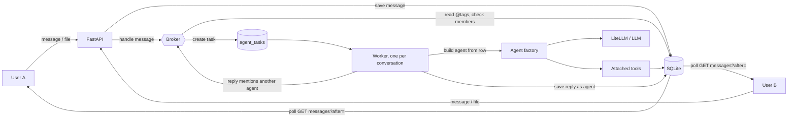
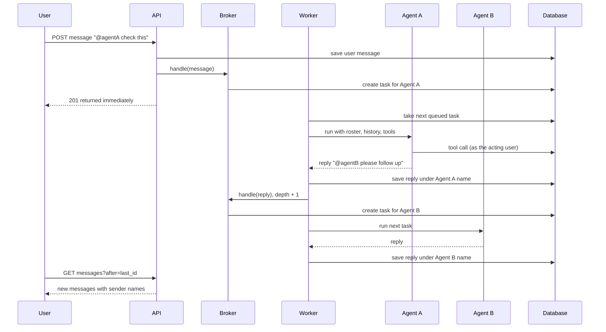
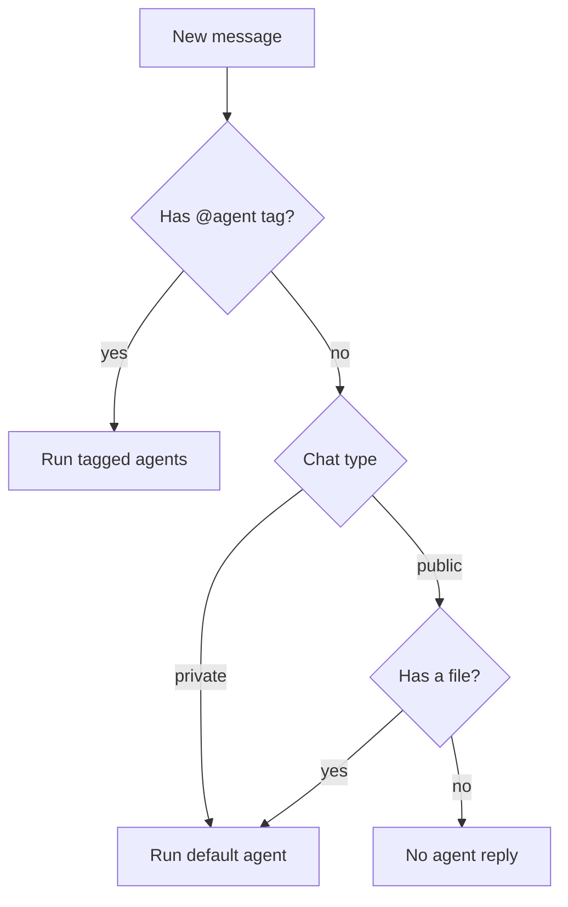

# Smart Invoice Reader (Backend)

A FastAPI backend for a group chat where humans and AI agents work together. Users upload invoice files (PDF or image), an agent reads them, and the data is saved in a structured database that can be searched and reported on.

The project started as "one user, one agent". It is now a multi-user, multi-agent chat with a hidden orchestrator (the **broker**) that decides which agent replies.

## Features

- **Auth**: register and log in with a JWT bearer token.
- **Public and private conversations**
  - Private: the owner plus agents only. Nobody can join.
  - Public: any user can browse and join.
  - Visibility is chosen at creation and can never change.
- **Members list**: users and agents live in one list, with roles (owner, member) and join dates.
- **Multi-agent chat**: several agents can be in the same conversation, each replying under its own name.
- **Mentions**: write `@agent_id` or `@username` to address someone. Only members of that conversation can be tagged.
- **Agent mates**: agents are database rows (name, id, description, role, system prompt) that users can create. Each agent only gets the tools attached to it.
- **Tools registry**: tools are written in code, registered automatically, synced into the database on startup, and then attached to agents.
- **Invoice processing**: extract number, dates, issuer, buyer, items, totals, then save them with company and contact records.
- **Search**: filter saved invoices by number, vendor, date range and amount.
- **Stop button**: cancels queued and running agent tasks.

## Tech stack

- Python 3.12, FastAPI, Uvicorn
- SQLAlchemy with SQLite (WAL mode)
- Agno (agent framework)
- LiteLLM as a gateway to the LLM (can be swapped for Gemini or another provider in one place)
- JWT auth (python-jose, passlib/bcrypt)

## Project structure

- `app/main.py`: app setup, CORS, routers, startup tasks.
- `app/agents/`: agent factory, tool registry, and the `tools/` folder (every file here is auto-imported so its tools register).
- `app/models/`: database tables.
- `app/schemas/`: request and response shapes.
- `app/routers/`: HTTP endpoints (users, auth, conversations, messages, files, agents, tools, invoices).
- `app/services/`: business logic, including `broker.py`, the orchestrator.
- `app/db/`: engine and session setup.
- `uploads/`: uploaded files, grouped by user and conversation.

## How it works

1. A user or agent saves a message in a conversation. Uploading a file also creates a message.
2. The message goes through the broker, which reads the `@tags` and checks them against the conversation members.
3. For each tagged agent, the broker creates a **task** in the `agent_tasks` table. It does not run it inline, so the API answers right away.
4. A background worker runs one task at a time per conversation. It builds the agent from its database row, gives it the member list, the recent messages and its own tools, then runs it.
5. The reply is saved as a message under the agent's own name.
6. If that reply tags another agent, the broker creates a new task. This is how agents talk to each other.

### Routing rules

- A message with `@agent` goes to that agent.
- A private chat with no tag goes to the default agent.
- A public chat with no tag gets no agent reply, so people can talk to each other freely.
- An uploaded file goes to the default agent in both chat types.
- An unknown tag produces a system message.

### Safety guards

- Maximum chain depth of 5 agent-to-agent hand-offs.
- A cap on active tasks per conversation.
- An agent cannot mention itself, and duplicate mentions are removed.
- Tools run as the **user who triggered the task**, not as the conversation owner.
- Tools marked not `public_safe` are switched off in public chats, so one user's invoices are not shown to everyone.
- Text inside messages and files is treated as data, never as instructions.
- Usernames and agent ids share one namespace so `@name` always points to one member.

## Communication diagrams

### Who talks to whom

### One request, step by step

### Public and private rules

## Main endpoints

- `POST /users/`, `POST /auth/token`: register and log in.
- `GET/POST /conversations/`, `GET /conversations/public`: list mine, list public, create.
- `POST /conversations/{id}/join`, `/leave`: join or leave.
- `GET /conversations/{id}/members`, `POST /conversations/{id}/agents`, `DELETE /conversations/{id}/members/{member_id}`: manage the member list.
- `POST /messages/{id}/new`, `GET /messages/{id}?after=`: send and poll messages.
- `GET /messages/{id}/tasks`, `POST /messages/{id}/stop`: see agent tasks and cancel them.
- `POST /files/upload`: upload an invoice file.
- `/agents`, `/tools`: create agents and attach tools.

## Getting started

1. Install dependencies with Poetry.
2. Create a `.env` file with `DATABASE_URL`, `SECRET_KEY`, `ALGORITHM`, `LITELLM_MASTER_KEY`, `DEFAULT_MODEL` and `ALLOW_ORIGINS` (comma separated).
3. Start LiteLLM locally on port 4000 with a model named `agent-llm`, or change the model in `app/agents/factory.py`.
4. Run the app with Uvicorn using **one worker only**, because the task queue lives in the process.
5. Register a user, create an agent (for example id `invoice`), attach the `invoice_tools` tool to it, then create a conversation with that agent as the default agent.

## Known limits and next steps

- Single process only. A real queue is needed to scale out.
- SQLite allows one writer at a time. Moving to Postgres is easy later.
- Stopping a task is cooperative: a tool that already committed (like saving an invoice) cannot be undone.
- The `requires_approval` flag is stored but not enforced yet.
- Planned: a manager agent with a `delegate` tool, an approval flow for sensitive tools such as email, realtime updates over SSE, and the frontend.
- The login token currently expires after 15 minutes, which will matter for polling.